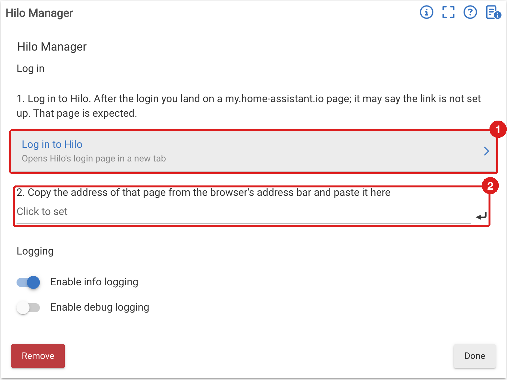
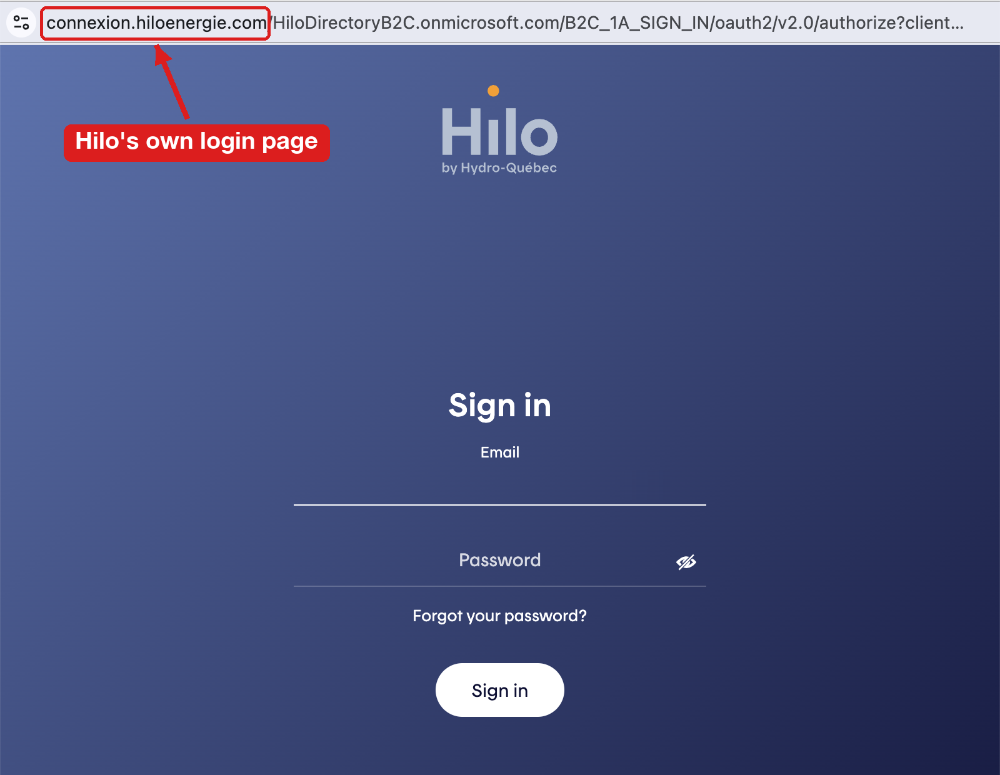
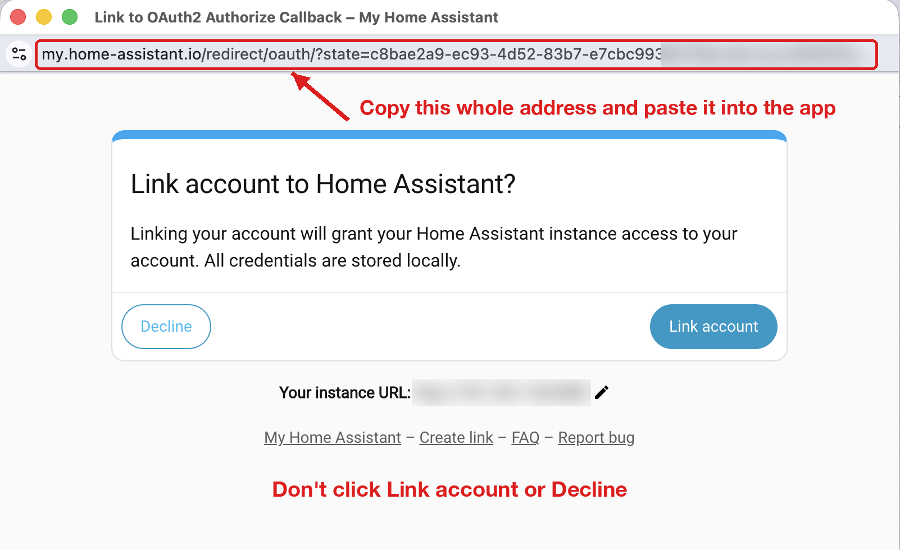

<!--
Copyright (c) 2026 PJ
SPDX-License-Identifier: MIT
-->

# Hilo Integration

Parent/child integration for [Hilo](https://www.hiloenergie.com/), Hydro-Québec's home energy service. The manager app logs in to a Hilo account, reads one location's hourly consumption, and keeps the full history in File Manager. A child device shows the day's energy and, pushed by Hilo about once a minute, the whole home's power from the utility meter.

## Components

| Component | Type | Description |
|---|---|---|
| **Hilo Manager** | App | Hilo login, hourly consumption read, history files in File Manager |
| **Hilo Energy Meter** | Driver | One device per location: energy today, yesterday and last hour, live power |
| `hilo-history.html` | Page | Charts the history files; served from File Manager |

## Installation

### 1. Add the code

In **Apps Code**, click **New App**, then **Import**, and paste:

```
https://raw.githubusercontent.com/iamtrep/hubitat/refs/heads/main/integrations/Hilo/HiloManager.groovy
```

Save. Do the same in **Drivers Code** (**New Driver** → **Import**) with:

```
https://raw.githubusercontent.com/iamtrep/hubitat/refs/heads/main/integrations/Hilo/HiloEnergyMeter.groovy
```

### 2. Add the app

**Apps** → **Add User App** → **Hilo Manager**. The page has two steps:



### 3. Log in to Hilo

Click **Log in to Hilo**. Hilo's sign-in page opens in a new tab, at `connexion.hiloenergie.com`. Sign in with your Hilo email and password.



### 4. Copy the address of the page you land on

After the sign-in, the browser lands on a **my.home-assistant.io** page. It may offer to link the account to Home Assistant, or say the link is not set up. Ignore it and **don't click anything on it**: the login code is in the page's address, and that is all the app needs.

Copy the whole address from the browser's address bar:



### 5. Paste it

Back in the app, paste the address into step 2 and press Enter. The app logs in and reads the account's location; if the account has several, pick one. The app then creates the device and starts reading, without waiting for **Done**. Press **Done** to close the page.

The address works once. If the app reports a login error, click **Log in to Hilo** again for a new one.

The app is renamed "Hilo Manager - <location>"; change the name under **Name** on the app page. The device is named "Hilo <location>". It then reads the account's history into File Manager in the background (see [History files](#history-files)).

One instance serves one Hilo location. For a second account or location, add another instance. A location already served by another instance is refused.

## Login

Hilo has no login of its own for third-party apps, so the manager uses the public client of the Home Assistant integration. Its only registered return address is my.home-assistant.io, hence the paste step. No Home Assistant install or account is needed. my.home-assistant.io receives the login code in the page address, as it does for Home Assistant users, but the code is useless without the PKCE verifier that only the app holds.

The refresh token is stored encrypted and renewed with each use. The access token lasts an hour and is kept in memory only, so a reboot or code update costs one refresh. If Hilo refuses the saved login (for example after a password change, or about 14 days without the hub reaching Hilo), the manager logs an error, stops polling, marks the device offline, and shows the login link again.

**Log out of Hilo** forgets the tokens and stops polling and the live stream.

## Device

### Hilo Energy Meter

- `energy` — kWh used today, from midnight local time
- `energyYesterday` — kWh used yesterday, set once all 24 hours are in
- `energyLastHour` / `lastHourStart` — kWh used in the latest hour Hilo has reported, and when that hour started
- `power` — the home's power in W, pushed by Hilo about once a minute
- `healthStatus` — `online` / `offline`. The event description gives the reason.
- `lastUpdate` — time of the last consumption read

Hilo publishes an hour's consumption with a delay of an hour or more, so `energy` lags the meter. **Refresh** reads consumption again and reopens the live stream if it has gone quiet.

The **Live power from Hilo** preference (on by default) keeps a connection open to Hilo for `power`. Turn it off to keep only the hourly reads.

## Polling

Consumption is read once an hour, at a minute between :10 and :50 picked at random each time the app settings are saved, so hubs do not all call Hilo at once. The device's **Refresh** reads it at once.

When Hilo can't be reached, each of the first two failed reads logs a warning. The third logs one error and marks the device offline, and a reminder follows every hour while the outage lasts. The first good read logs the recovery and marks the device online. When Hilo answers with `Retry-After`, polling pauses for that long, up to an hour.

The live stream is reopened with a fresh token every 50 minutes. When it drops or stays silent for 5 minutes, it reconnects after a delay that doubles from 5 s to 5 min. After 3 failed reconnects in a row, the device is marked offline until power arrives again.

## History files

The manager keeps every day's hourly consumption in File Manager, one file per month:

```
hilo-<location id>-energy-YYYY-MM.json
```

```json
{
  "unit": "kWh",
  "location": "<location id>",
  "days": {
    "2026-10-20": [ { "start": "2026-10-20T00:00:00-04:00", "kWh": 1.512 }, ... ]
  }
}
```

A day is written once all its hours are in. An hour Hilo has no value for is `null`.

On first setup the manager finds where the account's history starts, then reads it into the files one day a minute, so a year takes about six hours. The app page shows how many days are left.

### Browsing the history

`hilo-history.html` is a page that charts the files: daily totals, each day's hours, the average day by hour with the peak-event windows (6–9 and 16–20) marked, and a month table. Upload it to File Manager (**Settings → File Manager**); the app page then shows a **Browse the history** link, or open `http://<hub>/local/hilo-history.html`. It reads the files from the hub it is served by. With internet access it also overlays the hourly outdoor temperature at the hub's location (Settings → Hub Details), taken from [Open-Meteo](https://open-meteo.com/en/docs/historical-weather-api)'s historical model data, and adds a chart of daily use against mean outdoor temperature. It also marks Hydro-Québec's actual peak events, from the utility's [open data](https://donnees.hydroquebec.com/explore/dataset/evenements-pointe/) for the residential winter credit (offer CPC-D, the feed the Hydro Peak Events app uses): a mark on each event day, the event's hours shaded in purple on that day's chart, event days coloured in the temperature chart, and the average day drawn separately for event days. The 6–9 and 16–20 windows are shaded on days from December 1 to March 31. Drag across days on the daily chart to zoom every chart and table into that range; **Zoom out** (or Esc) goes back one step, and picking a month from the table is a step too. Without internet access the page shows the energy charts alone.

Read a file from another app or a script with `downloadHubFile`, or over HTTP from `http://<hub>/local/<file name>`.

## Credits

The client id, scope and API subscription key are those used by [python-hilo](https://github.com/dvd-dev/python-hilo) (MIT), the library behind the Home Assistant Hilo integration. No source is incorporated.

## License

MIT — see individual source files for the full license text.
